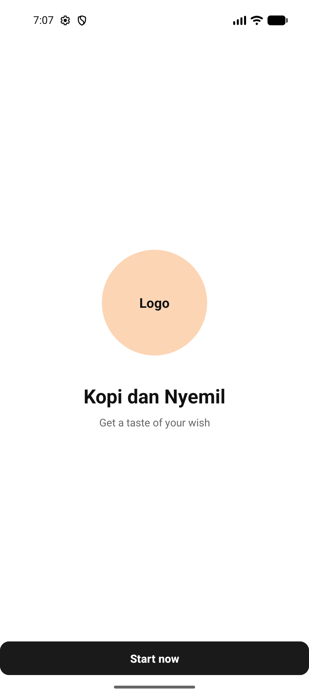
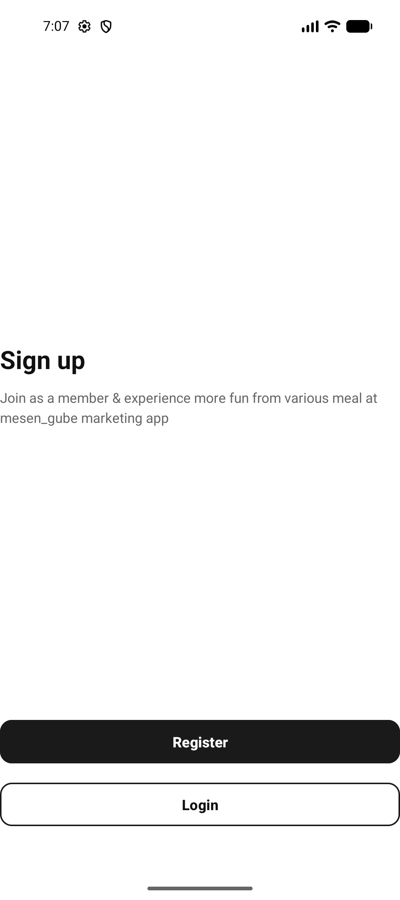
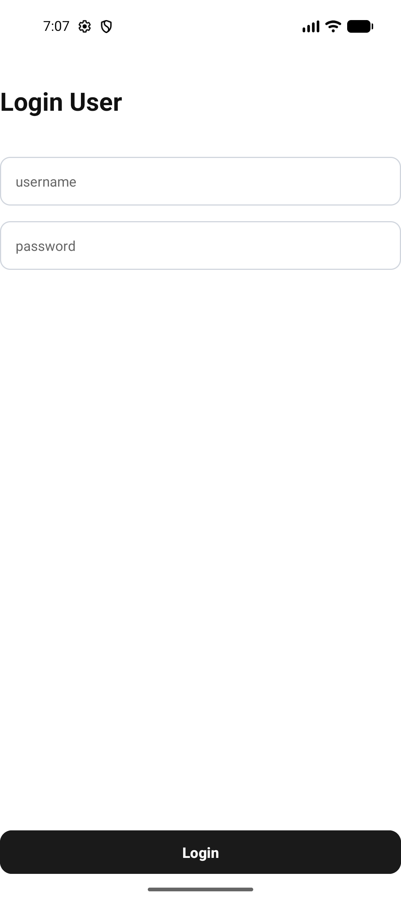
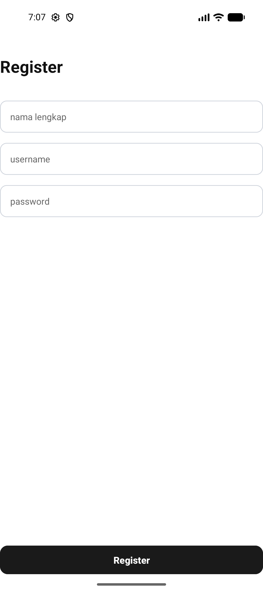
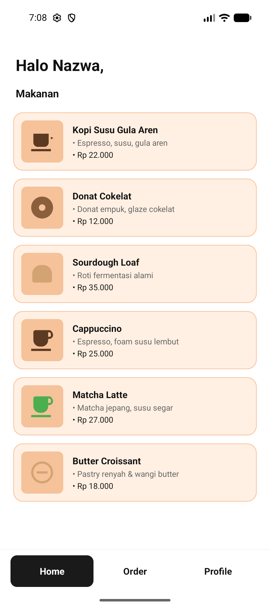
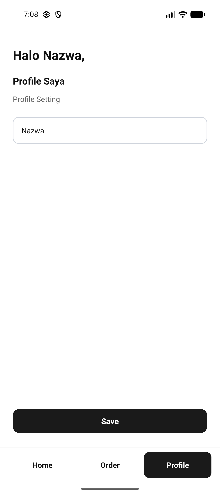
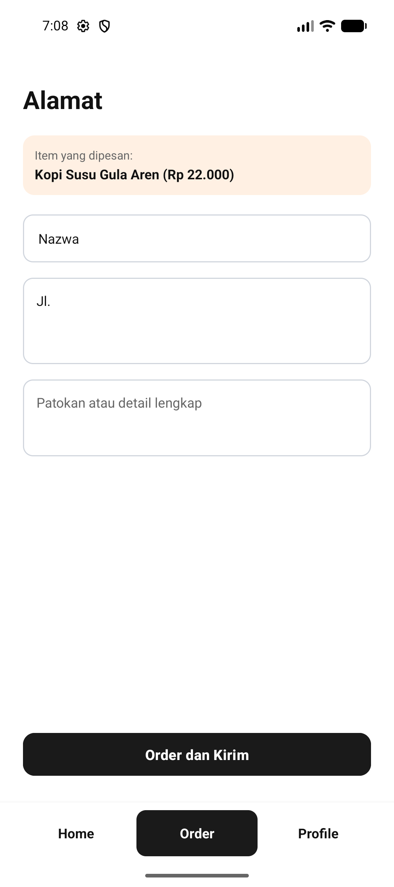
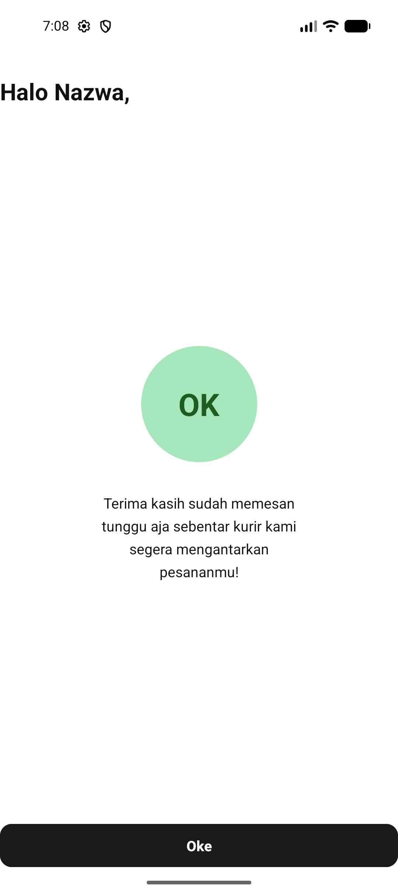

# Kopi dan Nyemil - Aplikasi Pemesanan Makanan & Minuman

Aplikasi mobile Android **"Kopi dan Nyemil"** dikembangkan untuk memenuhi tugas **Pemrograman Mobile**, dirancang dengan presisi 100% mengikuti rancangan wireframe UI/UX, serta menggunakan pendekatan Material Design 3 yang modern, intuitif, dan responsif.

---

## Daftar Isi
1. [Deskripsi Aplikasi](#-deskripsi-aplikasi)
2. [Dokumentasi Tampilan (Screenshots)](#-dokumentasi-tampilan-screenshots)
3. [Fitur & Kelengkapan Tampilan (Wireframe 8 Layar)](#-fitur--kelengkapan-tampilan-wireframe-8-layar)
4. [Komponen Penilaian & Bobot Nilai](#-komponen-penilaian--bobot-nilai)
5. [Teknologi yang Digunakan](#️-teknologi-yang-digunakan)
6. [Cara Menjalankan Aplikasi](#-cara-menjalankan-aplikasi)
7. [Author](#-author)

---

## Deskripsi Aplikasi

**Kopi dan Nyemil** adalah aplikasi pemesanan kopi dan makanan ringan (*snack*) yang dirancang untuk memberikan pengalaman pengguna yang cepat dan mulus. Aplikasi ini tidak memerlukan database eksternal dan memanfaatkan data statis (*dummy data*) serta penyimpanan lokal sesi pengguna (`SharedPreferences`) untuk memastikan alur navigasi dari awal hingga akhir berjalan tanpa hambatan.

---

## Dokumentasi Tampilan (Screenshots)

Berikut adalah galeri tangkapan layar asli (*screenshot*) dari 8 layar utama aplikasi **Kopi dan Nyemil**:

| 1. Splash Screen | 2. Sign Up Choice | 3. Login User | 4. Register |
|:---:|:---:|:---:|:---:|
|  |  |  |  |
| *Splash / Welcome Screen* | *Sign Up & Auth Choice* | *Login User Form* | *Register Account Form* |

| 5. Home (Daftar Menu) | 6. Profile | 7. Alamat Pengiriman | 8. Konfirmasi Pesanan |
|:---:|:---:|:---:|:---:|
|  |  |  |  |
| *Home / 6 Menu Pilihan* | *Profile Pengguna* | *Form Alamat Pengiriman* | *Konfirmasi Pesanan Kurir* |

---

## Fitur & Kelengkapan Tampilan (Wireframe 8 Layar)

Sesuai dengan ketentuan tugas, aplikasi ini mengimplementasikan seluruh alur dan komponen tampilan dari wireframe:

### 1. Splash / Welcome Screen (`SplashActivity`)
- Lingkaran badge logo warna peach (`#FCD5B5`).
- Judul aplikasi: **"Kopi dan Nyemil"**.
- Tagline: *"Get a taste of your wish"*.
- Tombol **"Start now"** untuk menuju ke menu pendaftaran/login.

### 2. Sign Up Choice (`SignUpChoiceActivity`)
- Judul: **"Sign up"**.
- Deskripsi: *"Join as a member & experience more fun from various meal at mesen_gube marketing app"*.
- Tombol **"Register"** (latar hitam) dan tombol **"Login"** (outline putih).

### 3. Login User (`LoginActivity`)
- Judul: **"Login User"**.
- Input field untuk `username` dan `password`.
- Tombol **"Login"** yang menyimpan sesi dan mengarahkan langsung ke halaman Home dengan sapaan **"Halo Nazwa,"**.

### 4. Register (`RegisterActivity`)
- Judul: **"Register"**.
- Input field untuk `nama lengkap`, `username`, dan `password`.
- Tombol **"Register"** yang mendaftarkan pengguna baru dan memperbarui sapaan otomatis menjadi **"Halo Nazwa,"**.

### 5. Home / Daftar Menu Makanan & Minuman (`HomeActivity`)
- Header sapaan personal: **"Halo Nazwa,"**.
- Kategori menu: **"Makanan"**.
- **Daftar Menu (Menampilkan 6 Item - Melebihi syarat minimal 5 item):**
  1. **Kopi Susu Gula Aren** (Rp 22.000) — *Espresso, susu, gula aren*
  2. **Donat Cokelat** (Rp 12.000) — *Donat empuk, glaze cokelat*
  3. **Sourdough Loaf** (Rp 35.000) — *Roti fermentasi alami*
  4. **Cappuccino** (Rp 25.000) — *Espresso, foam susu lembut*
  5. **Matcha Latte** (Rp 27.000) — *Matcha jepang, susu segar*
  6. **Butter Croissant** (Rp 18.000) — *Pastry renyah & wangi butter*
- **Custom Bottom Navigation:** Navigasi bawah dengan tab aktif **Home** berwarna hitam pekat.

### 6. Profile (`ProfileActivity`)
- Header sapaan, sub-judul *"Profile Saya"* dan *"Profile Setting"*.
- Kolom input nama pengguna yang terisi otomatis (*pre-filled*).
- Tombol **"Save"** untuk memperbarui nama profil secara instan di seluruh halaman aplikasi.
- Custom Bottom Navigation (tab **Profile** aktif).

### 7. Alamat Pengiriman / Order (`OrderAddressActivity`)
- Judul: **"Alamat"**.
- Kartu pratinjau (*card preview*) item makanan/minuman yang dipilih dari Home.
- Form input detail pengiriman: `Nama Lengkap`, `Alamat`, dan `Patokan atau detail lengkap`.
- Tombol **"Order dan Kirim"** untuk memvalidasi dan memproses pesanan ke tahap konfirmasi.
- Custom Bottom Navigation (tab **Order** aktif).

### 8. Konfirmasi Pesanan (`OrderConfirmationActivity`)
- Header sapaan **"Halo Nazwa,"**.
- Badge lingkaran hijau cerah dengan ikon centang dan teks **"OK"**.
- Pesan konfirmasi:
  > *"Terima kasih sudah memesan, tunggu aja sebentar kurir kami segera mengantarkan pesananmu!"*
- Tombol **"Oke"** untuk kembali ke halaman Home.

---

## Teknologi yang Digunakan

- **Bahasa Pemrograman:** Kotlin
- **Minimum SDK:** Android 8.0 (API Level 26)
- **Target SDK:** Android 14+ (API Level 37)
- **Arsitektur & UI:**
  - Material Components (Material 3)
  - ViewBinding (Safe type-checked view references)
  - ConstraintLayout & RecyclerView (List performa tinggi)
  - Custom Bottom Navigation Bar
  - Vector Drawables & Custom Shape Drawables
- **Manajemen Sesi:** `UserSessionManager` berbasis `SharedPreferences` untuk menyimpan data pengguna dan pesanan secara lokal.

---

## Cara Menjalankan Aplikasi

1. **Clone repository ini:**
   ```bash
   git clone https://github.com/nazwaa866-art/UTS-PAM-wawa.git
   ```
2. Buka **Android Studio**.
3. Pilih **Open** dan arahkan ke folder project `UTS-Wawa`.
4. Tunggu proses **Gradle Sync** selesai.
5. Jalankan aplikasi pada **Emulator Android** atau **Perangkat Fisik** dengan menekan tombol **Run (▶)**.

---

## Author

- **Nama:** Nazwa
- **Repository:** [GitHub - UTS-PAM-wawa](https://github.com/nazwaa866-art/UTS-PAM-wawa.git)
